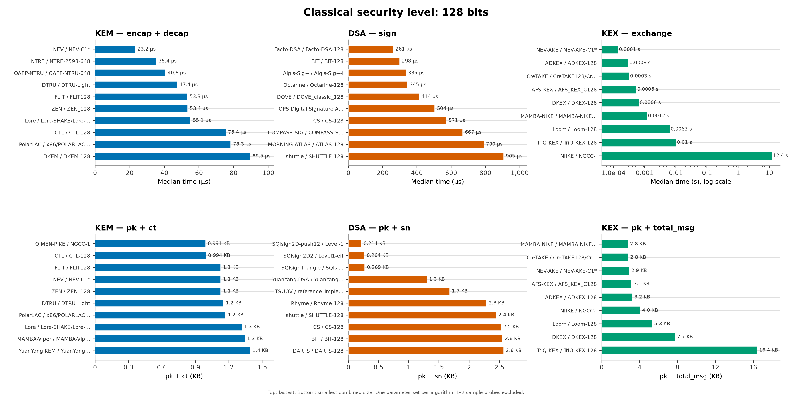
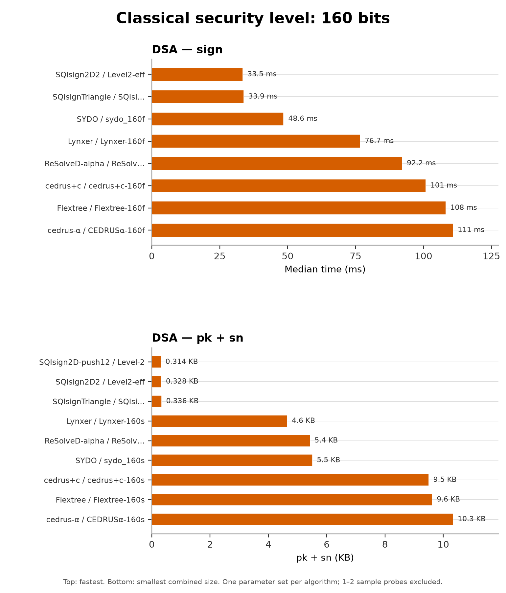
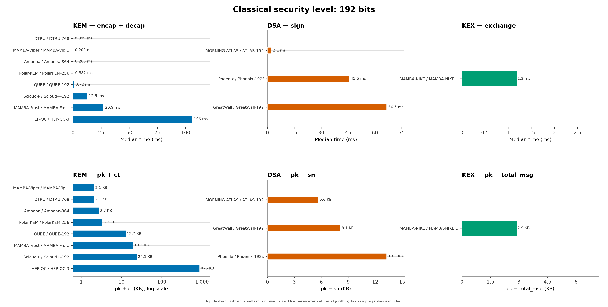
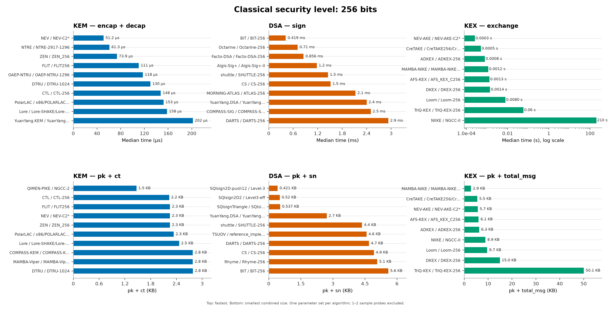
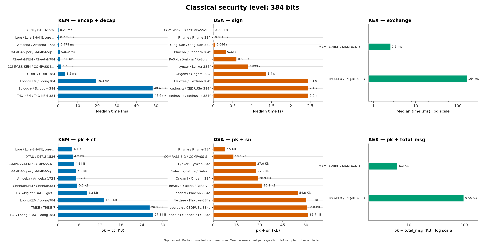
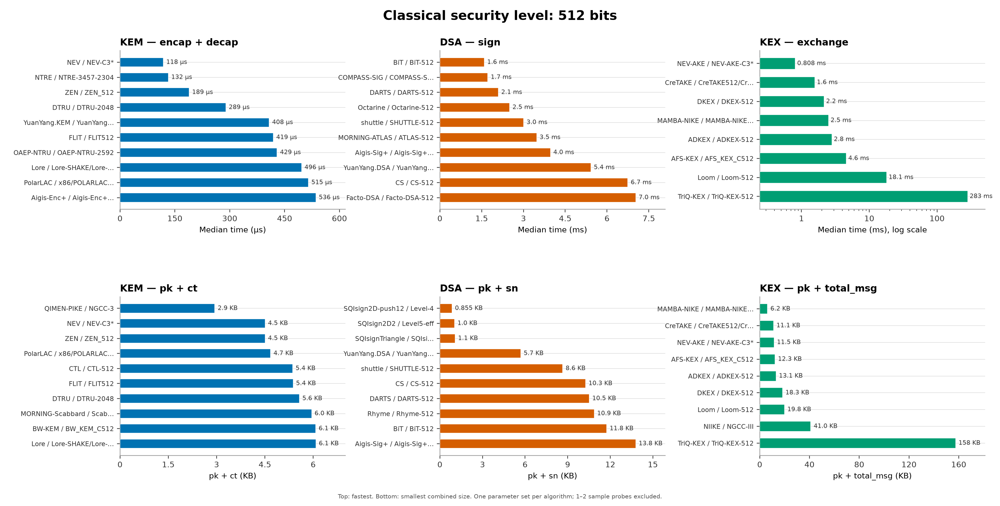

# Performance data

[中文](#中文)

Performance evaluation of the NGCC Round 1 public-key reference
implementations. Hash performance is not yet supported; `crypthash/` is
reserved.

## Scope

- `pkc/ref/{KEM,DSA,KEX}.csv`: 396 records (KEM 168 / DSA 170 / KEX 58).
- `pkc/opt/`, `pkc/add/`: reserved for optimized and additional
  implementations.
- `crypthash/`: reserved.

## Columns

Common columns are defined in the [root README](../README.md#common-columns).
Performance CSVs add:

| Column | Track | Meaning |
| --- | --- | --- |
| `samples` | all | number of executions per operation |
| `pk_bytes`, `sk_bytes`, `ct_bytes`, `ss_bytes` | KEM | public key, secret key, ciphertext, shared secret (bytes) |
| `pk_bytes`, `sk_bytes`, `sn_bytes` | DSA | public key, secret key, signature `sn_bytes` (bytes) |
| `keygen_*`, `encap_*`, `decap_*` | KEM | timings (ns) |
| `keygen_*`, `sign_*`, `verify_*` | DSA | timings (ns) |
| `init_a_*`, `init_b_*`, `exchange_total_*` | KEX | timings (ns) |
| `pk_bytes`, `sk_bytes`, `ss_bytes` | KEX | public key, secret key, shared secret (bytes) |
| `ct_bytes` | KEX | embedded KEM ciphertext, when documented (bytes) |
| `m1_bytes`, `m2_bytes` | KEX | protocol message sizes (bytes) |
| `total_msg_bytes` | KEX | total communication (bytes) |
| `sta_bytes`, `stb_bytes` | KEX | A/B state sizes (bytes) |
| `size_note` | KEX | `n/a` reason for fields the protocol does not have |
| `compile_flags` | all | exact compiler flags used |

Each timing group has `_median_ns`, `_min_ns`, `_max_ns`. `size_note` marks
KEX size fields that are structurally not applicable.

## Sorting

Rows are sorted by `ngcc_id`, then `classical_security_level`, then
parameter-set name. `classical_security_level` follows the level stated in the
submission documents; some parameter-set numbers are dimensions or lengths
rather than levels (e.g. `Aigis-Enc+-512/1024/2048` = 128/256/512,
`DTRU-648/Light` = 128).

## Measurement notes

- Times are per-operation **medians** over the recorded executions, measured
  on the reference C implementations with the baseline `-O3 -std=gnu11`
  (gcc 11.4.0); per-package deviations are visible in `compile_flags`.
- Flags are the common baseline plus per-package additions (`-fcommon`,
  `-fPIC`, parameter macros); `CS` is covered by the note below.
- All measurements were taken on a single machine: Intel Core Ultra 9 275HX,
  Linux 6.8, gcc 11.4.0.
- CPU frequency locking, core pinning, and warm-up are not part of the
  published protocol; timings are not corrected for frequency scaling.
- Most parameter sets were measured with 1000 executions; slow ones used
  16, 8, 7, 2, or 1 (see `samples`). Rows with 1–2 samples are capacity
  probes; treat their timings as indicative only.
- Values are raw measurements; they are **not** normalized to a specific CPU
  frequency and are not directly comparable with vendor optimized-
  implementation reports.
- CSV files are UTF-8 with BOM for direct use in Excel.

**Note on `CS`:** the vendor package does not build as-is (`ntt.c` refers to a
missing `NTT.h` and conflicts with `ntt.h`). `CS` was built with the public
reference build recipe (`-O2 -w`, linking its `libCS-*.so`), not from the
vendor's original build. Its rows are marked accordingly in `compile_flags`.

## Figures by security level

Each figure compares one classical security level (128 bits and above).
Top row: fastest parameter sets per track; bottom row: smallest combined size
(KEM/DSA/KEX). Each algorithm (package) appears at most once per panel. KEM
speed is `encap + decap`, DSA is `sign`, KEX is `exchange`; KEM size is
`pk + ct`, DSA is `pk + sn`, KEX is `pk + total_msg`. `size_note` marks KEX
fields that are structurally not applicable.
1–2 sample probes are excluded; panels with an extreme outlier use a log
x-axis, so every algorithm remains visible.

### 128 bits

### 160 bits

*Among the evaluated submissions, only DSA provides 160-bit parameter sets;
no KEM or KEX set uses this level.*

### 192 bits

### 256 bits

### 384 bits

### 512 bits

Rows without a documented formal level (or below 128) remain in the CSV but are
not plotted.

---

## 中文

NGCC 第一轮公钥参考实现的性能评估数据。哈希性能暂未支持，`crypthash/`
为预留目录。

### 范围

- `pkc/ref/{KEM,DSA,KEX}.csv`：396 条（KEM 168 / DSA 170 / KEX 58）。
- `pkc/opt/`、`pkc/add/`：优化实现、附加实现的预留目录。
- `crypthash/`：预留。

### 列

公共列见[根 README](../README.md#common-columns)。性能表另有：

| 列 | 赛道 | 含义 |
| --- | --- | --- |
| `samples` | 全部 | 每个操作的执行次数 |
| `pk_bytes`、`sk_bytes`、`ct_bytes`、`ss_bytes` | KEM | 公钥、私钥、密文、共享密钥（字节） |
| `pk_bytes`、`sk_bytes`、`sn_bytes` | DSA | 公钥、私钥、签名（字节） |
| `keygen_*`、`encap_*`、`decap_*` | KEM | 耗时（ns） |
| `keygen_*`、`sign_*`、`verify_*` | DSA | 耗时（ns） |
| `init_a_*`、`init_b_*`、`exchange_total_*` | KEX | 耗时（ns） |
| `pk_bytes`、`sk_bytes`、`ss_bytes` | KEX | 公钥、私钥、共享密钥（字节） |
| `ct_bytes` | KEX | 文档单列的 KEM 密文（字节） |
| `m1_bytes`、`m2_bytes` | KEX | 协议消息（字节） |
| `total_msg_bytes` | KEX | 总通信量（字节） |
| `sta_bytes`、`stb_bytes` | KEX | A/B 状态（字节） |
| `size_note` | KEX | 协议本身没有的字段的 `n/a` 说明 |
| `compile_flags` | 全部 | 实际编译旗标 |

每组耗时含 `_median_ns`、`_min_ns`、`_max_ns`。`size_note` 标出 KEX 尺寸中
协议本身没有的字段。

### 排序

按 `ngcc_id` → `classical_security_level` → 参数集名称排序。
`classical_security_level` 按提交文档声明的档位填写；少数参数集名称中的数字
是维度或长度而非档位（如 `Aigis-Enc+-512/1024/2048` = 128/256/512，
`DTRU-648/Light` = 128）。

### 测量说明

- 耗时为各操作的中位数；参考 C 实现基线为 `-O3 -std=gnu11`（gcc 11.4.0），
  个别包的偏差见 `compile_flags`。
- 编译旗标为统一基线加个别包附加项（`-fcommon`、`-fPIC`、参数宏）；
  `CS` 见下注。
- 单机测量：Intel Core Ultra 9 275HX、Linux 6.8、gcc 11.4.0。
- CPU 锁频、绑核、预热不在已公布的测量协议内；耗时未按频率归一化。
- 多数参数集 1000 次；慢参数集为 16、8、7、2 或 1 次（见 `samples`）。
  1–2 次为容量探针，耗时只作方向性参考。
- 数值为原始测量，未按 CPU 频率归一化，不能与厂商优化实现报告直接比较。
- CSV 为 UTF-8 BOM，可直接用 Excel 打开。

**关于 `CS`**：厂商包原样无法构建（`ntt.c` 引用的 `NTT.h` 缺失，且与
`ntt.h` 声明冲突）。`CS` 采用公开构建配方（`-O2 -w`，链接其 `libCS-*.so`），
不是厂商原样构建；`compile_flags` 中已注明。

### 按安全档位分图

每张图对比一个经典安全档位（128 起）：上排是该档各赛道最快的参数集，
下排是 KEM/DSA/KEX 合并尺寸最小的参数集。每个算法（包）在每个面板最多出现一次。
KEM 速度 = `encap + decap`，DSA = `sign`，KEX = `exchange`；
KEM 尺寸 = `pk + ct`，DSA = `pk + sn`，KEX = `pk + total_msg`；
`size_note` 标出协议本身没有的字段。
1–2 次采样的容量探针已排除；含极端离群值的面板改用对数横轴，
所有算法都保留。

#### 128 bit

#### 160 bit

*在本轮评估的提交数据中，只有 DSA 提供 160 bit 参数集；
KEM/KEX 没有使用该档位。*

#### 192 bit

#### 256 bit

#### 384 bit

#### 512 bit

无正式档位（或低于 128）的行保留在 CSV 中，但不进入图表。
